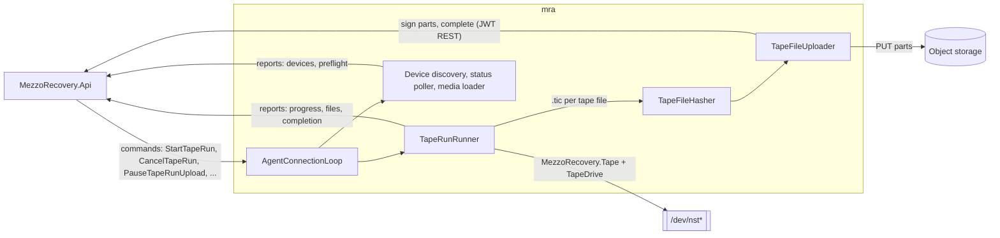

# MezzoRecovery Agent (`mra`)

[](https://github.com/Jandini/MezzoRecovery.Agent/actions/workflows/agent-tests.yml)
[](https://github.com/Jandini/MezzoRecovery.Agent/actions/workflows/agent-aot-scp.yml)

`mra` is the privileged Linux recovery host agent for the [MezzoRecovery](https://mezzorecovery.com) platform. It runs as a systemd service, connects outbound to the MezzoRecovery API via SignalR, and reports live status. One agent per machine.

## Architecture

`mra` is the only part of the platform that touches tape hardware. It holds one outbound SignalR connection to the Api, receives commands on it, and reports back. Image bytes go straight to object storage through pre-signed URLs. The agent never holds storage credentials.



- **Runs.** A Clone run reads the tape into one compact `.tic` file per tape file under `<cache>/runs/<runId>/`, hashes each file (SHA-256) and uploads it in 64 MiB parts. A Read run only reads and measures. One run per drive at a time.
- **Independent phases.** Reading can be stopped while uploads continue. Uploads can be paused, resumed or stopped without touching the drive.
- **Resume.** After a restart or reconnect the agent asks the Api for pending uploads, combines the server's completed parts with its local checkpoint file, and sends only what is missing.
- **Native AOT.** No reflection. Every type sent or received must be listed in `AgentJsonContext` (`Contracts/`), or it fails at run time.

Full description, message tables and sequence diagrams: [docs/ARCHITECTURE.md](../docs/ARCHITECTURE.md), sections 5 to 7. Known issues: [docs/ISSUES-AND-IMPROVEMENTS.md](../docs/ISSUES-AND-IMPROVEMENTS.md) (BUG-03, BUG-04, BUG-05, BUG-11 are in this repository).

## Requirements

- Linux x86_64 with systemd
- Root access for install and service management
- Network access to `https://io.mezzorecovery.com`

No .NET runtime required — `mra` is a self-contained Native AOT binary.

## Installation

Generate an enrollment code in the MezzoRecovery UI (Agents page), then run on the target Linux machine:

```bash
curl -fsSL https://mezzorecovery.com/agent/install | sudo bash -s CODE
```

Replace `CODE` with the 8-character code shown in the UI (e.g. `MK7P9D`). The code is one-time use and expires in 15 minutes.

The installer:
1. Downloads `mra-linux-x64` and verifies its SHA-256 checksum
2. Installs the binary to `/opt/mezzorecovery-agent/mra`
3. Creates a `/usr/local/bin/mra` symlink so `mra` is available in `$PATH`
4. Writes config to `/etc/mezzorecovery-agent/agent.json`
5. Runs enrollment (`mra enroll CODE`)
6. Installs and starts `mra.service` via systemd

## File layout

| Path | Purpose |
|------|---------|
| `/opt/mezzorecovery-agent/mra` | Agent binary |
| `/usr/local/bin/mra` | Symlink — puts `mra` in `$PATH` |
| `/etc/mezzorecovery-agent/agent.json` | Config (API base URL) |
| `/var/lib/mezzorecovery-agent/agent.credential` | Agent credentials (mode 600) |
| `/var/lib/mezzorecovery-agent/machine.id` | Durable machine identity (mode 600) |
| `/run/mezzorecovery-agent.lock` | Process lock — prevents duplicate instances |
| `/etc/systemd/system/mra.service` | systemd unit |


## Commands

```bash
# Enroll this machine (run once, requires root)
sudo mra enroll CODE

# Start the agent manually (normally run by systemd)
sudo mra run

# Check enrollment status
mra status

# Print the agent version
mra version

# Update to the latest binary (requires root)
sudo mra update

# Update without restarting the service
sudo mra update --no-restart
```

## Service management

```bash
# Check status
systemctl status mra

# Follow logs
journalctl -u mra -f

# Restart
sudo systemctl restart mra

# Stop
sudo systemctl stop mra
```

## Updating

To update the agent binary in place without re-enrolling:

```bash
sudo mra update
```

This downloads the latest `mra-linux-x64` from `https://mezzorecovery.com/agent/`, verifies the SHA-256 checksum, replaces the binary, refreshes the symlink, and restarts the service. Config, credentials, and machine identity are preserved.

## Repository layout

```
src/MezzoRecovery.Agent/        Agent executable (.NET 10, Native AOT, assembly name mra)
  AgentCli.cs, Program.cs       Command line
  Commands/                     enroll, run, status, version, update, restart
  Runtime/                      AgentConnectionLoop (hub connection, command handlers, upload resume), ProcessLock
  Api/                          HTTP clients: enroll, token, pending uploads, upload sessions
  Devices/                      Discovery, status poller, device state store, report publisher, media loader
  TapeOperations/               Run runner, file reporter, hasher, upload scheduler, multipart uploader, checkpoints, media control, preflight
  Contracts/                    Wire DTOs and the JSON source-generation context
  Configuration/                Config loader and option classes
  Identity/                     Machine id, credentials, fingerprint
  Logging/, Extensions/         Console formatter, DI registration
tests/MezzoRecovery.Agent.Tests/
deploy/install.sh               Bootstrap installer
```

## Build and test

```bash
dotnet test -p:UseProjectReference=true     # builds against sibling Tape and TapeDrive source
dotnet publish src/MezzoRecovery.Agent -c Release -r linux-x64 --self-contained true   # Linux only (Native AOT)
```

Without `-p:UseProjectReference=true` the build uses the pinned `MezzoRecovery.Tape` and `MezzoRecovery.TapeDrive` packages, which can lag the source.
## Public artifacts

Built by GitHub Actions and deployed to `https://mezzorecovery.com/agent/`:

| File | Description |
|------|-------------|
| `install` | Bootstrap installer script |
| `mra-linux-x64` | Native AOT binary (x86_64) |
| `mra-linux-x64.sha256` | SHA-256 checksum |
| `version.json` | Current version metadata |

## Security notes

- The agent never accepts inbound connections — all communication is outbound to the API.
- Enrollment codes are one-time use, hashed in the database, and expire after 15 minutes.
- Agent credentials and machine identity are stored with mode `600`.
- The process lock at `/run/mezzorecovery-agent.lock` prevents duplicate instances.
